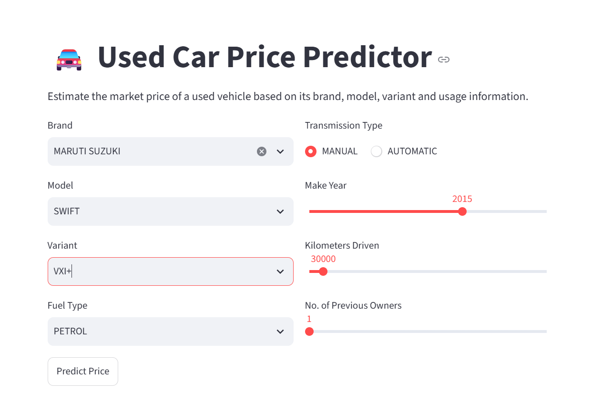

# 🚗 Used Car Price Prediction

An end-to-end machine learning project for predicting used car prices. The project covers data cleaning, exploratory data analysis, feature preparation, model development, model evaluation, and a Streamlit application for making price predictions.

## 🚀 Live Demo

👉 [Try the Used Car Price Predictor](https://used-car-price-prediction.streamlit.app/)

## 📌 Project Overview

The project uses multiple used-car datasets that were cleaned and analyzed before being prepared for machine learning.

**Workflow:** Raw datasets → Data cleaning & EDA → Model preparation → Model training → Model evaluation → Saved model → Streamlit application

## 🗂️ Project Structure

```text
used-car-price-prediction/
├── .gitignore
├── 01_dataset_1_analysis.ipynb
├── 02_dataset_2_analysis.ipynb
├── 03_dataset_3_analysis.ipynb
├── 04_dataset_4_analysis.ipynb
├── car_price_predictor.ipynb
├── car_price_predictor_application.py
├── utils.py
├── used_car_price_model.pkl
└── vehicle_lookup.pkl
```

## 📓 Notebooks

The first four notebooks contain the analysis and cleaning work for the individual datasets.

- `01_dataset_1_analysis.ipynb`
- `02_dataset_2_analysis.ipynb`
- `03_dataset_3_analysis.ipynb`
- `04_dataset_4_analysis.ipynb`

`car_price_predictor.ipynb` contains the machine-learning workflow, including preprocessing, model development, evaluation, and selection of the final model.

## 🚀 Streamlit Application

`car_price_predictor_application.py` contains the interactive Streamlit application.

Users can provide:

- Brand
- Model
- Variant
- Fuel type
- Transmission
- Manufacturing year
- Kilometres driven
- Number of previous owners

The application returns a predicted used-car price and a ±10% market range around the prediction.

### 📸 Application Screenshots

#### Input



#### Output


## 🤖 Machine Learning Workflow

1. **Data collection** — Used-car datasets were obtained from Kaggle.
2. **Data cleaning** — Individual datasets were inspected and cleaned, including missing-value handling and vehicle-related data processing.
3. **Exploratory Data Analysis** — The dataset-specific notebooks examine the data before model development.
4. **Feature preparation** — Numerical and categorical features are prepared for machine learning.
5. **Model development** — Linear Regression was used as a baseline, followed by Random Forest and XGBoost. XGBoost tuning was also performed.
6. **Model saving** — The trained model and required preprocessing information are stored in `used_car_price_model.pkl`.
7. **Application** — The saved model is integrated into the Streamlit application.

## 📁 Supporting Files

- `used_car_price_model.pkl` — saved trained model and preprocessing objects required by the application.
- `vehicle_lookup.pkl` — vehicle lookup information used by the application.
- `utils.py` — reusable data-cleaning and preprocessing utilities.

## 📊 Data

The original raw and cleaned datasets are not included in this GitHub repository because some files are large.

The `.gitignore` excludes raw/cleaned datasets, CSV files, Python cache files, Jupyter checkpoints, virtual environments, and local environment files.

The notebooks document the data-analysis and cleaning workflow used to prepare the data.

## 🛠️ Technologies Used

- Python
- Pandas
- NumPy
- Scikit-learn
- XGBoost
- Joblib
- Jupyter Notebook
- Streamlit

## 🧩 Project Components

| Component | Purpose |
|---|---|
| Dataset analysis notebooks | Dataset inspection, cleaning and exploratory analysis |
| `car_price_predictor.ipynb` | Machine-learning workflow |
| `utils.py` | Reusable data-processing and cleaning functions |
| `used_car_price_model.pkl` | Saved trained model and preprocessing objects |
| `vehicle_lookup.pkl` | Vehicle lookup data for the application |
| `car_price_predictor_application.py` | Streamlit prediction application |

## 🔮 Future Improvements

- Add model monitoring and retraining workflows
- Improve prediction accuracy with additional features
- Add more comprehensive model evaluation and visualizations
- Automate data and model pipelines

## 👨‍💻 Author

**Biprasish Singha**

GitHub: [biprasish-singha](https://github.com/biprasish-singha)
