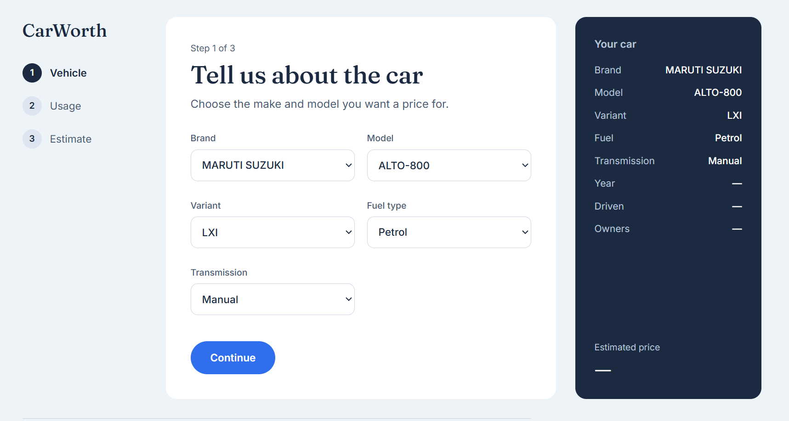
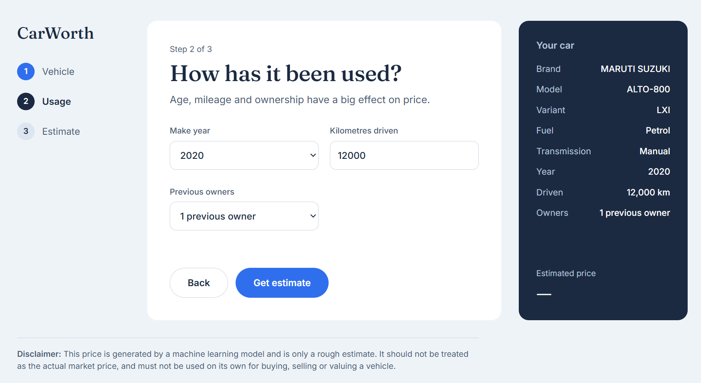
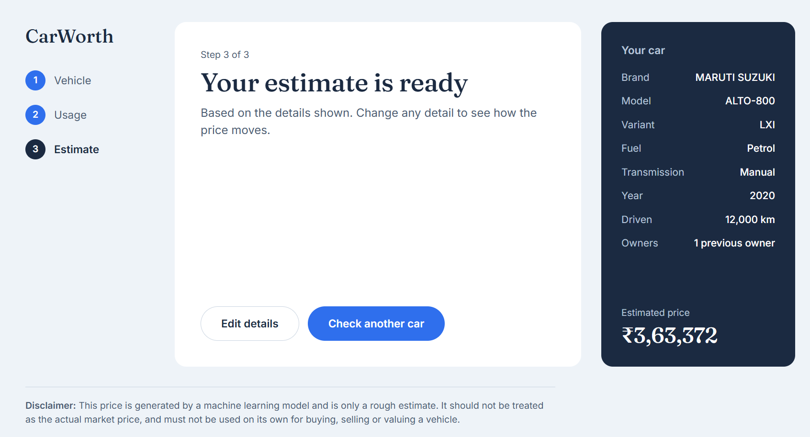

# 🚗 CarWorth – Used Car Price Estimator

A machine learning web app that estimates the price of a used car in India. Pick a brand, model, variant and a few usage details, and get an instant price estimate.

**Live demo:** https://carworth-used-car-price-predictor-1.onrender.com/ 
**API docs:** https://carworth-used-car-price-predictor.onrender.com/docs

> ⚠️ **Disclaimer:** Prices are generated by a machine learning model and are only rough estimates. They should not be used as the actual market price for buying, selling or valuing a vehicle.

---

## ✨ Features

- Guided 3-step form: **Vehicle → Usage → Estimate**
- Dependent dropdowns: brand → model → variant, loaded live from the API
- Vehicle specifications (body type, engine size, weight, power and so on) are looked up automatically, so users only enter what they know
- Still returns an estimate when the exact variant/fuel/transmission combination isn't in the data, by falling back to the closest match
- Responsive layout, with clear error and loading states

## 🧠 How it works

```
Browser (HTML/CSS/JS)  ──►  FastAPI  ──►  specification lookup  ──►  XGBoost pipeline  ──►  price
```

1. The user selects brand, model, variant, fuel type and transmission, then enters year, kilometres driven and previous owners.
2. The API looks up the remaining specifications from `vehicle_specifications.pkl`.
3. The full feature row goes to the trained model pipeline, which returns the predicted price in ₹.

## 📸 Screenshots

| Step 1: Vehicle | Step 2: Usage |
|:---:|:---:|
|  |  |

| Step 3: Estimate |
|:---:|
|  |

## 📊 Data

Four public used-car datasets from Kaggle were cleaned, standardised to a common schema and combined (about 57k records before cleaning):

| # | Dataset | Source |
|---|---------|--------|
| 1 | Cars India Pre-owned | `mrmars1010/cars-india-pre-owned` |
| 2 | Cars24 used car data | `amanrajput16/used-car-price-data-from-cars24` |
| 3 | Used Car Dataset | `vanshhala/used-car-dataset` |
| 4 | CarDekho used cars | `sukritchatterjee/used-cars-dataset-cardekho` |

Key preparation steps:
- Standardised brand, model and variant names (for example `SWIFT DZIRE` / `SWIFT-DZIRE` → one name)
- Removed erroneous prices (for example post-2010 cars under ₹50,000, excluding the Tata Nano)
- Filled missing specifications from records of the same variant, then the same model, plus manual fixes for well-known models
- Dropped weak features with many missing values and removed duplicate records
- Used a log transform on price because the distribution is heavily right-skewed

## 🤖 Model

Three regressors were trained on a stratified 80/20 split (stratified by price decile), all wrapped in a pipeline with scaling, one-hot encoding and a log-price target:

| Model | MAE (₹) | Median AE (₹) | RMSLE | Test R² | CV R² |
|-------|--------:|--------------:|------:|--------:|------:|
| Linear Regression | 132,055 | 61,190 | 0.23 | 0.79 | 0.84 ± 0.03 |
| Random Forest | 152,181 | 66,818 | 0.24 | 0.62 | 0.79 ± 0.06 |
| **XGBoost (deployed)** | **110,810** | **51,704** | **0.21** | **0.79** | **0.86 ± 0.04** |
| XGBoost (tuned) | 113,883 | 52,424 | 0.21 | 0.76 | 0.86 ± 0.04 |

XGBoost gave the best overall accuracy, and the untuned version generalised better than the tuned one, so it was deployed.

**Known limitation:** errors are much larger for luxury cars (the top 1% of prices), because there are few of them in the data. Treat estimates for premium models with extra caution.

## ☁️ Deploy on Render

**API (Web Service)**
- Root directory: `backend`
- Build command: `pip install -r requirements.txt`
- Start command: `uvicorn app:app --host 0.0.0.0 --port $PORT`
- Set the `PYTHON_VERSION` environment variable to match the version you trained with

**Front end (Static Site)**
- Root directory: `frontend`
- Publish directory: `.`
- Before deploying, set `API_BASE_URL` in `script.js` to your API's Render URL

Then restrict CORS in `app.py` by replacing `allow_origins=["*"]` with your static site URL.

> The free Render tier spins down after inactivity, so the first request can take around a minute.

## 🛠️ Tech stack

Python · pandas · scikit-learn · XGBoost · FastAPI · Uvicorn · vanilla HTML/CSS/JavaScript

## 📌 Possible improvements

- Add a price range instead of a single number
- Add more recent data and more luxury-segment records
- Show feature importance or a plain-language explanation with each estimate

## 👤 Author

Biprasish Singha · [LinkedIn](https://linkedin.com/in/biprasish-singha) · [GitHub](https://github.com/biprasish-singha)

